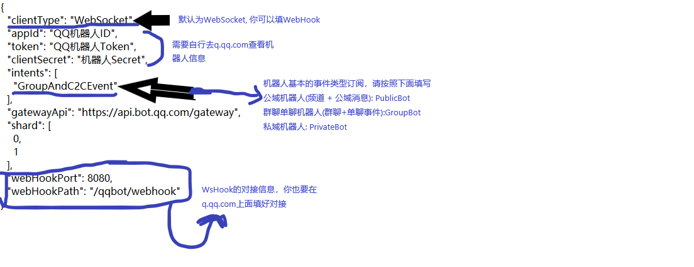
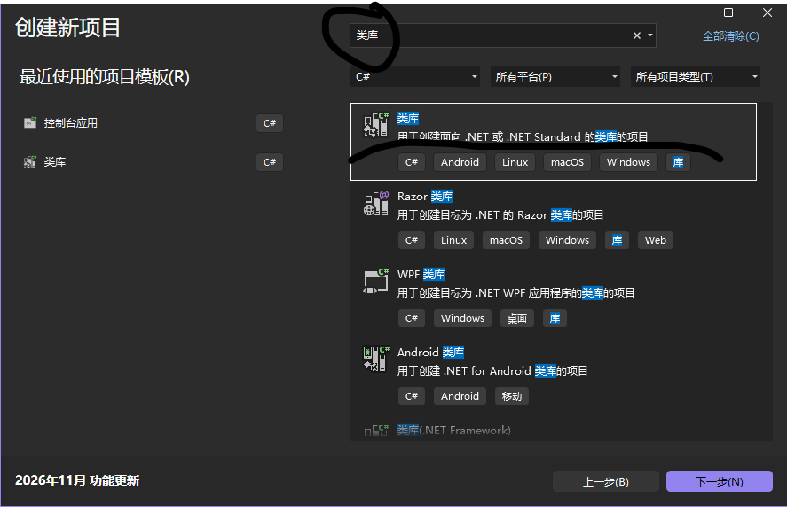
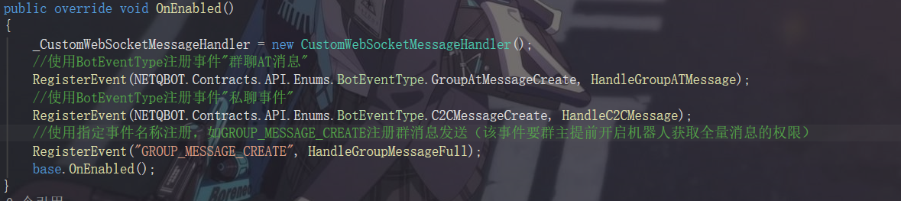

# NETQBOT
一个基于C#构建的QQ机器人框架，可以使用WebSocket和WebHook进行连接\
使用QQ官方机器人，不使用第三方框架，所以不会被封
# 安装
Windows(Win10/Win Server2019以上):
 - 1, 点击[下载最新](https://github.com/GrayRainStudio/NETQBOT/releases/latest)然后下载"NETQQBOTv.(版本号).zip"
 - 2, 解压，建议使用[7zip](https://www.7-zip.org/)
 - 3, 解压完毕后，进入文件夹，双击"NETQBOT.exe"即可启动，第一次启动会报错，但是这是正常现象，有些人会要求安装.NET 9 按照指引安装就行了。
 - 4, 在第一次运行完成环境部署后，打开"(运行目录)\NETQQBot\Bot.json",按照要求完成信息填写
 - 
 - 5, 事件订阅配置, 可看[配置事件](https://github.com/GrayRainStudio/NETQBOT/edit/main/README.md#%E4%BA%8B%E4%BB%B6)
然后再次启动"NETQBOT.exe"如果没问题就会显示机器人的名称, 如:\
\
此时你的NETQQBOT就搭建好了，但是没有功能啊，没关系，本仓库提供了插件的编写以及一些API的功能介绍, 如果你不是从事这方面的专家，可以去[插件市场](https://github.com/GrayRainStudio/NETQBot-PluginStores)找到你想要的插件，然后安装\
# 插件编写
本框架使用.NET 9.0 编写，所以你需要在VisualStudio里创建一个类库项目，但是是适用于.NET的\
\
然后框架选择".NET 9.0", 然后创建\
此时要把"NETQQBOTv.(版本号).zip"里的NETQBOT.Contracts.dll引用到，它是框架的核心API. 然后分别创建"Plugin.cs"和"Config.cs"文件作为插件主类和配置文件类\
Plugin类要承接"Plugin<TConfig>"接口，TConfig泛指则填你创建的Config类，然后按要求重写插件消息，此时你可以在OnEnabled的重写方法里使用RegisterEvent方法去订阅事件啦!!\
插件生成后把插件Dll和依赖Dll(对包括那个NETQBOT.Contracts.dll)复制到"(运行目录)\NETQQBot\Plugins"里就行了, 然后重启NETQBOT就可以看到插件被启动啦\
详细的API内容请看[Wiki](https://github.com/GrayRainStudio/NETQBOT/wiki)
# 事件
事件是一个非常重要的东西 < = > \
在"Bot.json"中，你可以更改"intents"的值来修改你的QQ机器人的事件订阅类型，如(可以看[配置事件](https://github.com/GrayRainStudio/NETQBOT/edit/main/README.md#%E4%BA%8B%E4%BB%B6)):\
 - 1, PublicBot -> 公域机器人常用：频道 + 公域消息\
 - 2, GroupBot -> 群聊单聊机器人常用：群聊 + 单聊事件\
 - 3, PrivateBot -> 私域机器人\
 - 注意：一定要根据你的机器人有没有过公域来选择，否则无法使用\
在插件编写的时候需要根据[腾讯事件列表](https://bot.q.qq.com/wiki/develop/api-v2/dev-prepare/event-emit/payload.html#%E4%BA%8B%E4%BB%B6%E8%AE%A2%E9%98%85-intents)去订阅事件，当然你可以使用插件系统内置的RegisterEvent方法去注册事件，如:\

# 问题
 - Q: 为什么机器人启动了，但是网页端显示断开?\
 - A: 刷新网页端\
 - Q: 为什么机器人开全量消息收取权限AT后指令没效果?\
 - A: 开了全量消息权限需要订阅GROUP_MESSAGE_CREATE事件，然后做AT判断\
 - Q: 为什么显示IP不在白名单?\
 - A: 打开[IP138](ip138.com)检测你电脑的IP，然后去[QQ控制端](q.qq.com)添加/修改白名单，然后重启NETQBOT.exe
 - Q: 为什么群里AT它没用?\
 - A: 如果开了沙箱，请检测是否是在沙箱群里AT它的，如果不是，请检测是否为公域机器人
# 感想
在2026年的9月多，我以为不会用Python写QQbot就在想有没有一个基于C#的QQ机器人框架，可以很简单的帮助我，但是我没找到，所以我跟DS彻夜长谈后写出了这个框架，在此感谢Ds老师了
